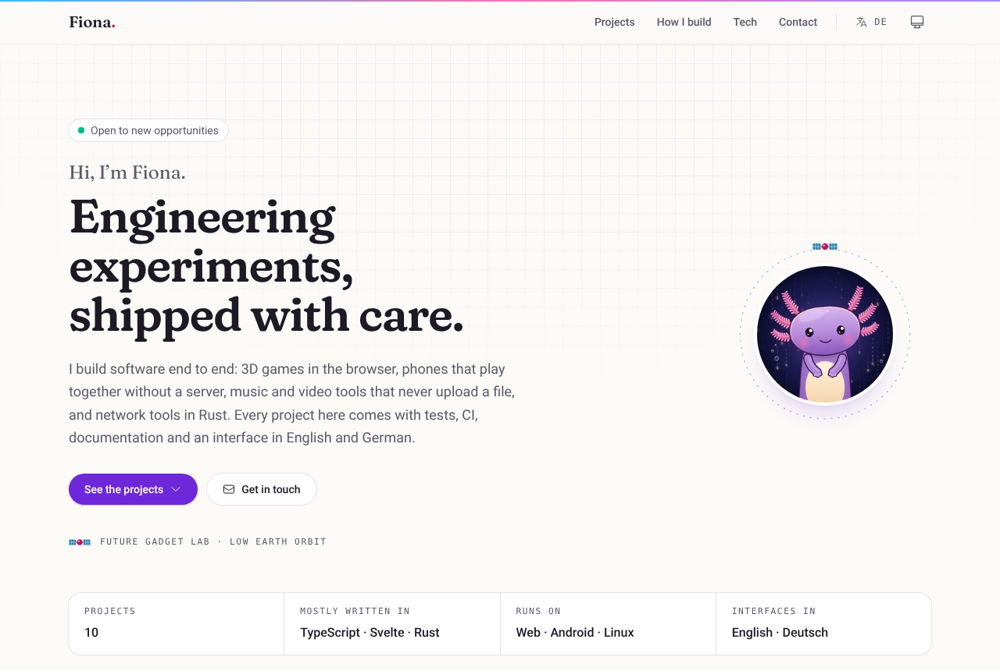
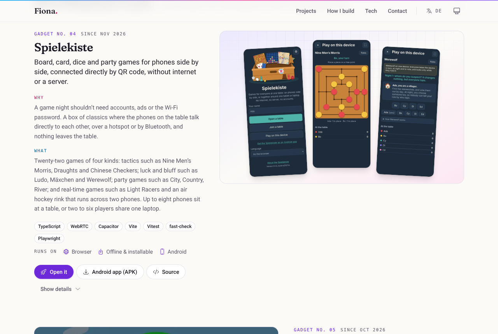
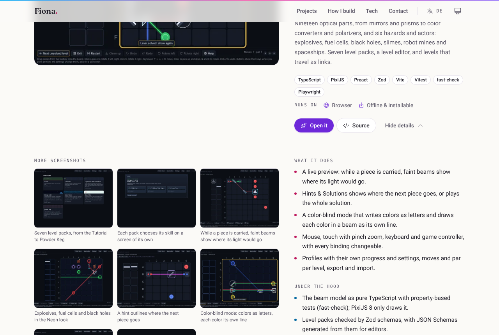
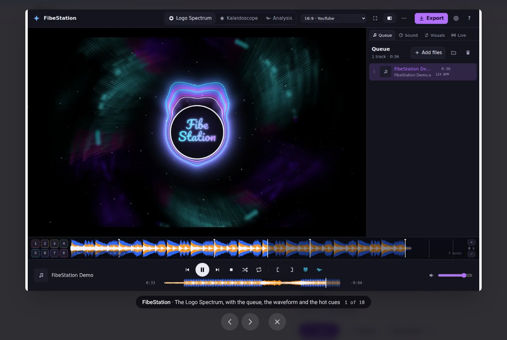
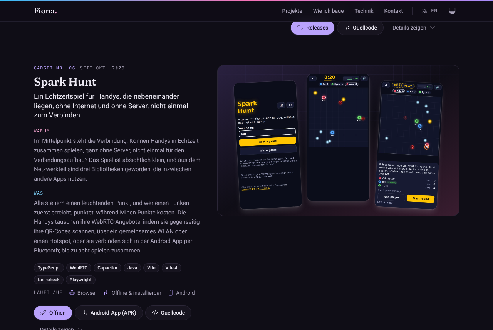
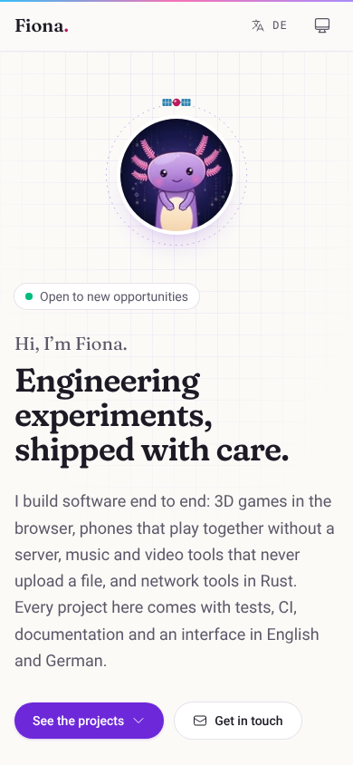
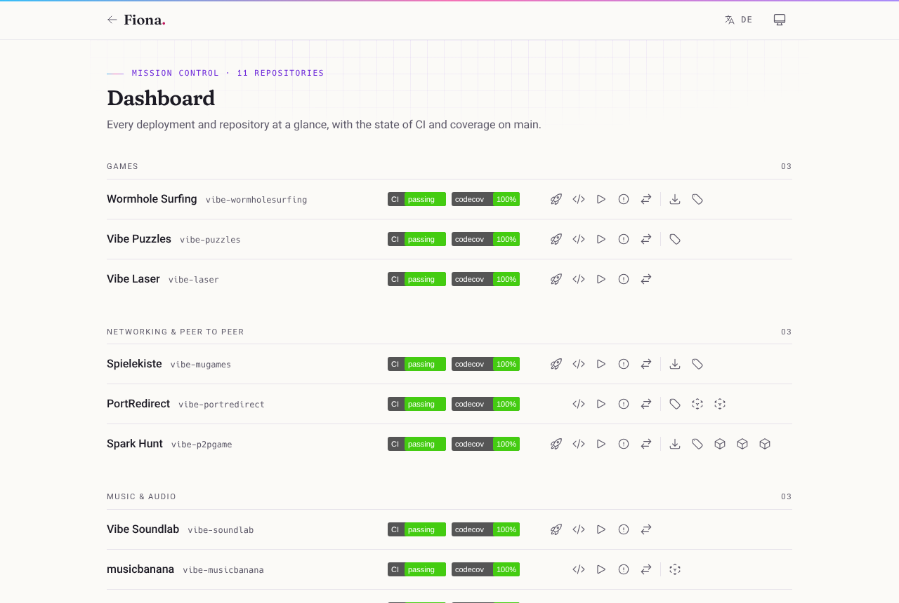

# fionapreroll.github.io

[](https://github.com/FionaPreroll/fionapreroll.github.io/actions/workflows/ci.yml)
[](https://codecov.io/gh/FionaPreroll/fionapreroll.github.io)

Fiona's homepage: a portfolio of recent projects, to link from a profile or a CV. Eleven projects in four groups, each with a screenshot, why it was made, what it does, its stack and where it runs; their details fold out with more screenshots, how they are built and tested, and links to their READMEs, docs, releases and packages. In English and German, light and dark, and printable as a PDF.

**Live:** [fionapreroll.github.io](https://fionapreroll.github.io), in German at [fionapreroll.github.io/de/](https://fionapreroll.github.io/de/).



## Screenshots

|                                                                                                 |                                                                                                             |
| ----------------------------------------------------------------------------------------------- | ----------------------------------------------------------------------------------------------------------- |
|  |  |
| A project, with its screenshots, motivation, summary, stack and platforms.                      | Its details: more screenshots, what it does, how it is built, and every link.                               |
|                                     |                                          |
| The lightbox: arrow keys, swiping, Escape.                                                      | Auf Deutsch, in dark colors.                                                                                |



`pnpm screenshots` takes these pictures again (see [Screenshots of the page](#screenshots-of-the-page)).

## Getting started

You need Node.js 22.12 or newer (CI uses Node 24) and pnpm. `package.json` pins pnpm 12.15.0, and pnpm 10 or newer switches to that version by itself.

```sh
pnpm install
pnpm dev
```

`pnpm dev` serves the page at http://localhost:5173 and reloads on every change.

## Scripts

| Script                         | What it does                                                                                             |
| ------------------------------ | -------------------------------------------------------------------------------------------------------- |
| `pnpm dev`                     | Development server with hot reload                                                                       |
| `pnpm build`                   | Prerenders the site into `build/`: `/`, `/en/` and `/de/`                                                |
| `pnpm preview`                 | Serves `build/` on port 4173                                                                             |
| `pnpm check`                   | Type check, lint and unit tests with coverage; run it before every push                                  |
| `pnpm typecheck`               | `svelte-check` over components, TypeScript, tests and tools                                              |
| `pnpm lint`, `pnpm format`     | Prettier and ESLint: check, or fix both                                                                  |
| `pnpm test`, `pnpm test:watch` | Vitest unit and component tests                                                                          |
| `pnpm test:coverage`           | The same with coverage in `coverage/`; fails below 95 %                                                  |
| `pnpm test:e2e`                | Builds, then runs the Playwright browser tests                                                           |
| `pnpm screenshots`             | Builds, then takes the README's screenshots and `static/og.png` with Playwright                          |
| `pnpm shots`                   | Fetches the projects' screenshots and the avatar from GitHub (see [below](#screenshots-of-the-projects)) |

Playwright needs a Chromium: run `pnpm exec playwright install chromium` once, or set `CHROMIUM_PATH` to an installed Chromium binary.

## Stack

SvelteKit 3 with Svelte 5 (runes) and `adapter-static`, so every page is prerendered to HTML; Tailwind CSS 4, Heroicons and TypeScript; Vite 8, Vitest 5 with Testing Library and happy-dom, Playwright with axe, ESLint and Prettier; sharp for the screenshots. The fonts are self-hosted: [Fraunces](https://github.com/undercasetype/Fraunces) with its SOFT axis for headings and [Roboto](https://github.com/googlefonts/roboto-3-classic) for text, both from [Fontsource](https://fontsource.org/), and [Hack](https://github.com/source-foundry/Hack) for the little labels in capitals.

## Project layout

```
src/
  content/      the projects (projects.ts), the profile, the practices, and shots.json from pnpm shots
  i18n/         English and German texts (en.ts, de.ts), t(), l() and the month format
  lib/          the language rules and the color theme
  ui/           the components: Home.svelte puts the page together
  routes/       [[lang=lang]]: /, /en/ and /de/, and the dashboard under each, all prerendered
  params.ts     the matcher for [[lang]]
  hooks.server.ts  writes the language into <html lang> while prerendering
  app.html      the page around it, with the script that sets theme and language before the first paint
  app.css       Tailwind, the fonts, the color tokens, print styles
tools/          pnpm shots: fetches and converts the projects' screenshots
tests/e2e/      Playwright browser tests
tests/screenshots/  the README's screenshots and the link preview
static/         copied as it is: screenshots, avatar, favicon, 404.html, robots.txt, sitemap.xml, og.png
```

## Content

Everything about the projects lives in `src/content/projects.ts`, in the order of the page: the group (`games`, `networking`, `audio`, `everyday`, in `GROUPS` of `types.ts`), the month of the first commit, tagline, motivation, summary, features and engineering notes, each as `{ en, de }`, the stack, the platforms, the links and the screenshots. The motivations are drafts written from the READMEs; change them freely.

- **Links** have a kind (`live`, `apk`, `releases`, `packages`, `docker`, `readme`, `docs`, `changelog`, `privacy`) that picks their icon and, without a `label`, their text. The card's own buttons are its `live` and `apk` links, or else the first `releases` or `docker` link, and always the source on GitHub; the details list every link.
- **Screenshots** are paths in the project's repository. `hero` is either one wide picture, or two or three of a phone held upright, which stand side by side; `focus: 'top'` keeps the top of a tall picture in the frame. `gallery` holds the rest, shown in the details. After changing them, run `pnpm shots`.
- **The numbers** ("Gadget No. 01") follow the order on the page and stay the same while the projects are filtered.
- **Practices** (`practices.ts`) are the six tiles of "How I build"; `seenIn` names the projects they link to. **The profile** (`profile.ts`) holds the name, the contact address, the GitHub account and whether the hero says "Open to new opportunities".

`src/content/content.test.ts` checks that the eleven repositories are there, each text in both languages, every link on https and every screenshot fetched.

## Languages

English is at `/` and `/en/`, German at `/de/`; all three are prerendered, with `<html lang>`, `hreflang` links, canonical addresses and Open Graph tags of their own. Addresses under `/en/` and `/de/` never move, so they are the links to give for a CV in one language. An address without either, `/` or `/dashboard/`, moves to its German one before the first paint (the script in `src/app.html`) when German was chosen with the switch in the header, or, with nothing chosen, when the browser asks for German first. The switch remembers the choice in `localStorage` under `lang`, and leads to the same page in the other language.

Every text of the page goes through `t()` from `useI18n()` (`src/i18n`), whose catalogs `en.ts` and `de.ts` must have the same keys: `de.ts` is typed against `en.ts`, so a missing text fails the type check, and a test compares their placeholders. Texts in `src/content/` are `{ en, de }` pairs, shown with `l()`. Components never import from `$app`: they get the language from `Home.svelte`'s context and what else they need as props, so they render the same in Vitest.

## Dashboard

`/dashboard/` (and `/en/dashboard/`, `/de/dashboard/`) is a compact page for Fiona herself: every project, in the groups of the homepage, and this site, each in one row with the badges of its CI on `main` and its Codecov coverage, and links to its deployment, repository, Actions, issues and pull requests, then its downloads (the Android app, releases, packages and Docker images). Only a small link at the end of the footer leads there, with `rel="nofollow"`, and the page asks search engines not to index it; anyone who knows the address can still open it.



Its rows come from `src/content/dashboard.ts`, which builds them from `projects.ts`: each project's `ci` names the workflow whose badge shows (`ci.yml`, or `rust-test.yml` for PortRedirect) and whether it reports coverage. The badges are images from GitHub and Codecov, so they show the state of now; the README's picture uses stand-ins, so that it does not change with CI.

## Design

A lab notebook, quietly: graph paper behind the hero and the contact section, little labels in Hack capitals, the projects numbered as gadgets of the Future Gadget Lab, a satellite circling the avatar, and a 404 page lost in orbit. The accents are violet, pink and sky, as in the hairline along the top.

- **Colors** are tokens in `src/app.css` (`paper`, `surface`, `ink`, `muted`, `line`, `accent`, `pink`, `sky`, …), which the `dark` class on `<html>` redefines. The theme switch goes through the system's colors, light and dark, and remembers its choice under `theme`; `src/app.html` applies it before the first paint.
- **Motion** stays small and stops for visitors who ask for less of it (`prefers-reduced-motion`).
- **Details** are always in the HTML, for search engines and printing, and fold away in a grid row; folded, they are `inert` and hidden.
- **Printing** (and saving as a PDF) uses light colors, opens every project's details, leaves out buttons, menus and galleries, and writes the address after every link in the details.

## Screenshots of the projects

`pnpm shots` (`tools/shots.ts`) reads every screenshot path in `projects.ts`, fetches the file from the repository's `main` branch, writes it as WebP 640 and 1440 pixels wide (never wider than the original) into `static/shots/<repository>/`, and lists each with its size in `src/content/shots.json`, which the page reads for `srcset`, `width` and `height`. SVGs are copied as they are, and refused if they hold scripts or event handlers. It also fetches the GitHub avatar, and removes pictures no project names any more. `SHOTS_FROM=<folder>` reads the repositories from clones in that folder instead.

The Project screenshots workflow (`.github/workflows/shots.yml`) runs it every Monday and by hand, and opens a pull request when a picture changed.

## Tests

- **Unit and component tests** (`src/**/*.test.ts`, `tools/*.test.ts`) run in Vitest with happy-dom; components render through Testing Library, with the texts of a language from `src/test/render.ts`. `pnpm test:coverage` fails below 95 % for lines, statements, functions or branches. Two kinds of code that the Svelte compiler adds to every component are left out of the count, as no test can reach them: the `?? ''` behind every `{value}` in markup, and the hot reloading of the dev server (`ignoreNode` in `vite.config.ts`).
- **Browser tests** (`tests/e2e/`) build the site and use it in Chromium: the pages in both languages without errors, every picture loading, what search engines and link previews read, the language rules and the switch, the details, links to a project, the filter, the lightbox, the theme, printing, a phone without sideways scrolling, and no accessibility violations found by axe, in light and dark colors and with the lightbox open.

## CI and deployment

CI (`.github/workflows/ci.yml`) runs the type check, lint, the unit tests with coverage, the build and the browser tests on every pull request and push to `main`. Coverage goes to [Codecov](https://codecov.io/gh/FionaPreroll/fionapreroll.github.io) (`codecov.yml`), signed in with GitHub's OIDC token, so the repository needs no Codecov secret; its checks fail below 95 % too. Once everything passes on `main`, `pages.yml` builds the site and deploys `build/` to GitHub Pages, which must be set to **GitHub Actions** under Settings → Pages.

### Screenshots of the page

`pnpm screenshots` (`tests/screenshots/readme.spec.ts`) takes the README's pictures into `docs/screenshots/` and the link preview `static/og.png` (1200 × 630), each again only where the page changed. The Screenshots workflow (`.github/workflows/screenshots.yml`) does the same on GitHub when started by hand and opens a pull request with them. Both workflows that open pull requests need "Allow GitHub Actions to create and approve pull requests" under Settings → Actions → General.

## Changelog and versions

`CHANGELOG.md` follows [Keep a Changelog](https://keepachangelog.com/en/1.1.0/); changes visitors can see go under `## [Unreleased]`. A version is made only when asked: the entries move to a new `## [x.y.z] - YYYY-MM-DD` section, `package.json` gets the same version, and the commit is tagged `vx.y.z`.

## License

There is no license yet. The fonts keep theirs: Fraunces and Roboto under the SIL Open Font License, Hack under the MIT License with the Bitstream Vera License; Heroicons are under the MIT License. The screenshots show the projects of this account.
